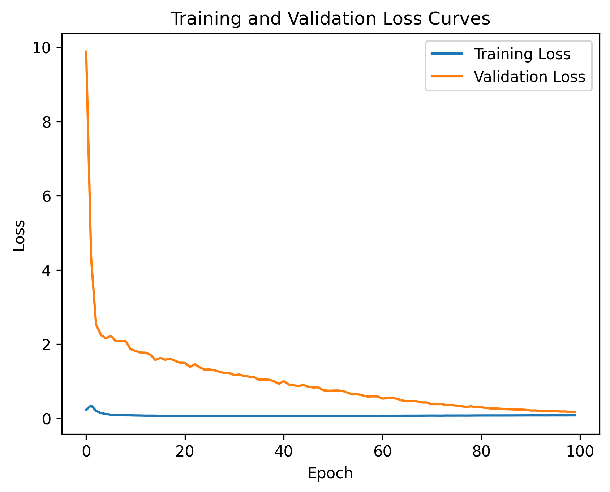

# Loan Default Prediction


A loan-default classification project that evaluates a recall-focused neural network and compares its decision behaviour with a logistic-regression baseline. The current neural-network result is **97.25% recall** at a 0.50 threshold. The extended workflow also examines threshold trade-offs, illustrative error-cost scenarios and probability calibration.

---

## Why Recall Matters

False negatives and false positives have different consequences. This project reports both types of error and examines how threshold choices change their balance. The relative costs used in scenario analysis are explicitly illustrative, not measured lender losses.

| Metric | Value |
|--------|-------|
| Accuracy | 93.10% |
| Precision | 69.66% |
| **Recall** | **97.25%** |
| False Negative Rate | 2.75% |

---

## Architecture

```
┌─────────────┐     ┌──────────────┐     ┌──────────────────┐     ┌──────────┐
│  Loan Data  │────▶│  SMOTEENN   │────▶│  Neural Network  │────▶│  Predict │
│  (Excel)    │     │  Resampling │     │  4 Dense Layers  │     │  Default │
└─────────────┘     └──────────────┘     │  30-30-15-15     │     └──────────┘
                                          │  + Dropout 50%   │
                                          │  + L2 Regularise │
                                          │  + Exp LR Decay  │
                                          └──────────────────┘
```

### Model Specs

| Layer | Neurons | Activation | Regularisation |
|-------|---------|------------|----------------|
| Dense 1 | 30 | ReLU | L2 + Dropout 50% |
| Dense 2 | 30 | ReLU | L2 + Dropout 50% |
| Dense 3 | 15 | ReLU | L2 + Dropout 50% |
| Dense 4 | 15 | ReLU | L2 + Dropout 50% |
| Output | 1 | Sigmoid | — |

### Training Curve



---

## Key Features

- **Class Imbalance Handling** — SMOTEENN (SMOTE + Edited Nearest Neighbours) oversamples minority class and cleans noisy samples
- **Regularisation Stack** — L2 weight decay + 50% dropout + exponential learning rate decay prevent overfitting
- **Decision-threshold analysis** — Thresholds selected on validation data and assessed on a separate test set
- **Reproducible Pipeline** — Single Python script with fixed random seeds

---

## Decision-focused evaluation

The training script now compares the neural network with a class-weighted logistic-regression baseline. The neural network uses SMOTEENN on the training split; the baseline uses class weights on the original training rows.

Thresholds from 0.05 to 0.95 are evaluated on validation data. For each model, the script selects thresholds under illustrative false-negative to false-positive cost ratios of 5:1, 10:1 and 20:1, then reports the selected threshold's performance on the held-out test data. These cost units are scenario assumptions, not actual financial losses or lending-policy recommendations.

The script also reports ROC AUC and Brier score, exports calibration-bin comparisons, and saves logistic-regression coefficients as directional model explanations. Coefficients describe model associations and are not causal effects.

Running the script creates:

- `outputs/model_comparison.csv` — test-set metrics at the 0.50 threshold
- `outputs/threshold_cost_scenarios.csv` — validation-selected thresholds and test-set results by illustrative cost ratio
- `outputs/logistic_regression_coefficients.csv` — signed logistic-regression coefficients
- `outputs/calibration_bins.csv` — mean predicted probability and observed default rate by quantile bin

The project analyses a historical dataset. It does not monitor a live lending portfolio, implement a credit policy, measure actual customer outcomes or establish regulatory compliance.

## Project Structure

```
├── loan default project.py   # Training and decision-analysis pipeline
├── loan_data.xlsx            # Input dataset
├── loss_curves.png           # Training/validation loss plot
├── outputs/                  # Generated evaluation tables
└── README.md
```

---

## Installation & Usage

```bash
git clone https://github.com/Piyali-Narnaware/Loan-Default-Prediction.git
cd Loan-Default-Prediction
pip install tensorflow scikit-learn imbalanced-learn pandas numpy matplotlib openpyxl
```

Run the full pipeline:

```bash
python "loan default project.py"
```

---

## Dependencies

- Python 3.11+
- TensorFlow / Keras
- scikit-learn, imbalanced-learn
- pandas, numpy, matplotlib, openpyxl
